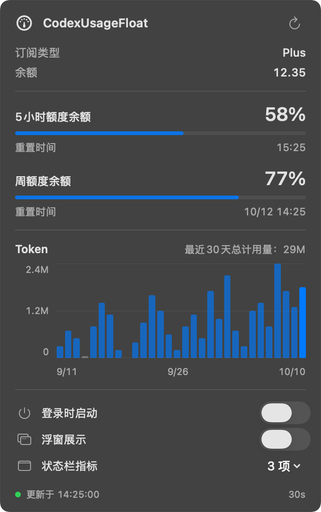

# CodexUsageFloat

**English** · [简体中文](README_CN.md)

A macOS menu bar app that keeps your Codex quota, reset times, and token usage in view.

[Download](https://github.com/pspgbhu/CodexUsageFloat/releases/latest) · [Report an issue](https://github.com/pspgbhu/CodexUsageFloat/issues)

<p align="center">
  
</p>

- **Quota at a glance.** View your subscription plan, credits, remaining quota, and reset times.
- **30-day usage history.** Hover over the chart to inspect individual days.
- **Your choice of display.** Select menu bar metrics or move them into a draggable floating window.
- **Automatic updates.** Refreshes every 30 seconds by default, with manual refresh, launch at login, and English and Simplified Chinese interfaces.

The preview uses sample Plus data. The quota periods shown depend on your subscription and the data available from Codex.

## Install

You need **macOS 13 or later** and a signed-in Codex client installed in `/Applications` as `ChatGPT.app` or `Codex.app`. Release packages support Apple Silicon and Intel Macs.

1. Download the `.dmg` from [Releases](https://github.com/pspgbhu/CodexUsageFloat/releases/latest).
2. Open it and drag `CodexUsageFloat.app` into Applications. For a `.zip` download, extract it and move the app there.
3. Open CodexUsageFloat, then click its menu bar icon to view your usage.

The app runs without a Dock icon. Launch at login is enabled by default and can be turned off in the panel.

## Use

| Action | How |
| --- | --- |
| Open the usage panel | Click the menu bar icon. |
| Refresh now | Click the refresh button at the top of the panel. The footer shows the last successful refresh time and refresh interval. |
| Choose visible metrics | Use **Menu Bar Metrics** in the panel. Select quota, reset time, or credits; choose **Icon only** to hide the text. |
| Show a floating window | Enable **Floating window**, then drag it into position. Selected metrics move to the window; the menu bar keeps its icon. |
| Change language or quit | Right-click the menu bar icon or floating window. |
| Inspect a day's token usage | Hover over its column in the chart. |

### Reading the numbers

- **Quota percentages show what remains.** The current panel shows five-hour and weekly windows for Plus, and a weekly window for Pro. Other plans use recognized windows reported by Codex; missing values appear as unavailable.
- **Credits are separate from quota percentages.** Numeric balances display at most two decimal places.
- **Tokens are historical usage, not a remaining allowance.** The chart covers the past 30 days, including today. Its total sums only reported days; missing days are not treated as zero.
- **A stale warning means the last refresh failed.** Previously retrieved values stay visible until a refresh succeeds. Data freshness also depends on what Codex reports.

## Troubleshooting

| Symptom | What to check |
| --- | --- |
| Login required or data unavailable | Open your Codex client, confirm you are signed in, then refresh the panel. |
| Refresh stops after a client update | Update CodexUsageFloat and reopen it. The app supports both the current nested Codex CLI location in ChatGPT and older bundled locations. |
| Data is marked stale | Check your connection and that the Codex client works, then refresh again. The displayed values are from the last successful refresh. |
| macOS cannot verify the developer | Confirm the download came from this project's Releases. For an unnotarized build, use **System Settings → Privacy & Security → Open Anyway** after attempting to open it. |
| Launch at login fails after moving the app | Open it from its new location, then turn **Launch at login** off and back on. |

For a reproducible problem, [open an issue](https://github.com/pspgbhu/CodexUsageFloat/issues) with your macOS, Codex client, and CodexUsageFloat versions, steps to reproduce, and the visible error. Remove account details and credentials from screenshots or logs.

## Update or uninstall

**Update:** Quit CodexUsageFloat, replace it with the new version from [Releases](https://github.com/pspgbhu/CodexUsageFloat/releases/latest), and reopen it. Keep it in the same location so the login item still points to the app.

**Uninstall:** Disable **Launch at login** in the panel, quit the app, and delete it from Applications.

## Data and privacy

CodexUsageFloat asks the local Codex app server for account and usage information using the client's existing login. You do not enter a password or API key in this app. It saves display preferences and keeps fetched usage in memory, without storing its own copy of login credentials or usage history.

The app focuses on Codex. Token usage is supplied by Codex; it is not estimated from your conversations.

## Build from source

Use a macOS Swift toolchain that supports Swift tools version 5.9 or later. Running the test suite also requires XCTest.

```bash
git clone https://github.com/pspgbhu/CodexUsageFloat.git
cd CodexUsageFloat
swift build -c release
swift test
scripts/package-app.sh
open dist/CodexUsageFloat.app
```

The packaging script produces `dist/CodexUsageFloat.app` and falls back to direct `swiftc` compilation if SwiftPM fails. This fallback packages the app; it does not run the test suite. If `swift test` reports that XCTest is missing, use an Xcode toolchain that includes it.

| Location | Purpose |
| --- | --- |
| `Sources/AgentUsageCore` | Usage models, provider protocol, Codex app-server client, and response mapping. |
| `Sources/CodexUsageFloat` | SwiftUI/AppKit interface, preferences, and login item management. |
| `Tests/AgentUsageCoreTests` | Core model, formatting, protocol, and executable discovery tests. |
| `scripts/` | App packaging, release artifacts, and LaunchAgent installation/removal. |

For contribution constraints, see [AGENTS.md](AGENTS.md). For signing, notarization, and release packaging, see the [release guide](docs/releasing.md) (Chinese).
